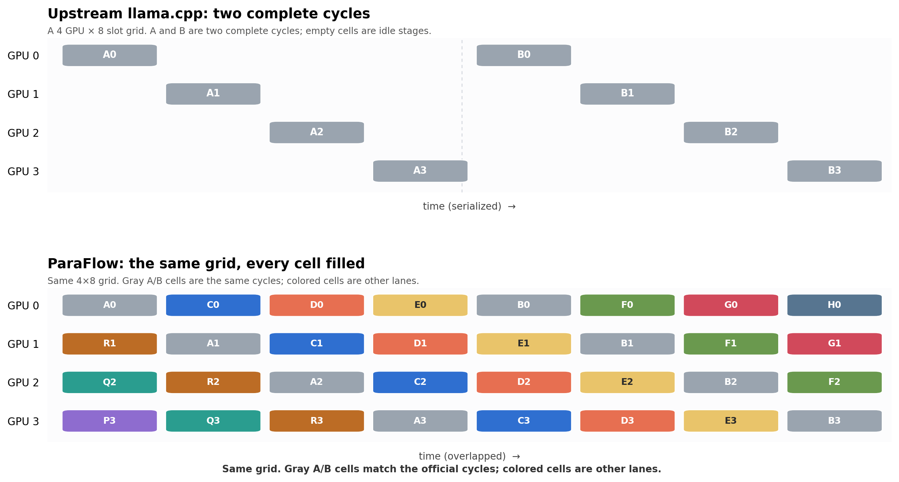
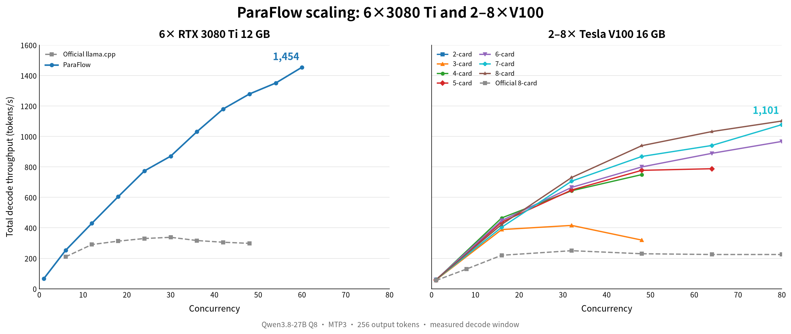

# ParaFlow

**English** | [简体中文](README.zh-CN.md)

**Multi-GPU pipeline inference for llama.cpp.**

ParaFlow turns several GPUs into a decode pipeline that stays busy: requests are split into lanes and staggered across GPUs. Upstream llama.cpp PP runs one batch at a time; ParaFlow fills the idle stages with the next lane.

ParaFlow is built to eliminate that GPU waste. It keeps every GPU busy on ordinary PCIe 2.0/3.0 servers, with no NVLink and no tensor-parallel rewrite; the remaining GPU capacity is utilized at over 98% efficiency (for example, 4-card C32 single-stream throughput is on par with upstream llama.cpp at C8).

- **Runs on PCIe**: PP plus multiple lanes scale on ordinary PCIe 2.0/3.0 servers.
- **Small cards count**: 2×V100 16 GB at C8 reaches 225.7 t/s, above one V100 32 GB at 147.0 t/s.
- **High-concurrency throughput**: 6×3080 Ti C60 1,454 t/s; 8×V100 C80 1,101 t/s, about 4.9× upstream llama.cpp.
- **Source-complete**: stays llama.cpp; model format and quantization are unchanged.


## Multi-GPU acceleration: keep every stage fed

Layer split gives you the stages. It does not automatically keep them busy.

With upstream llama.cpp, one batch moves through the GPUs at a time. While it samples, waits for KV, or moves between prompt chunks, the other stages have nothing to do. ParaFlow keeps multiple lanes in the pipeline:



The GPU count does not change. Stage 1 can process lane B while stage 0 prepares lane C, and a finished lane can be sampled. ParaFlow combines pipeline lanes, asynchronous decode tickets, dynamic KV, and MTP so the wait between stages is filled by the next lane.

## Performance

### Decode



*Total decode throughput vs concurrency. Qwen3.8-27B Q8, MTP3, 256 output tokens; official llama.cpp and ParaFlow measured at the same concurrency.*

- **6× RTX 3080 Ti 12 GB**: C60 = **1,454 t/s**. The curve is still rising at C60; further concurrency was blocked by the context budget, not by a throughput plateau.
- **8× V100 16 GB**: C80 = **1,101 t/s** vs upstream llama.cpp 225 t/s, **4.9×**. The point is the mean of repeated C80 runs.
- **2× V100 16 GB vs 1× V100 32 GB**, C8: **225.7 vs 147.0 t/s** (+53.5%). Per-GPU work match: 225.7 vs 2×112.1 = 224.2 t/s, **≈100%**.
- At C1 the two engines are close. The acceleration comes from concurrency, not from making a single request faster.

These tests were mainly run on small-memory cards. The same model and scheduler remain valid on large-memory cards, which can hold more context and get more out of the GPU cores.

### Context

- 6× RTX 3080 Ti total KV pool: **432K tokens** measured.
- 8× V100 total KV pool: **1088K tokens** measured (1088Ki / 34 slots, 32K per-sequence cap; first and last slot outputs matched).

## Quick start

Tested on V100 (SM70) and RTX 3080 Ti (SM86); Linux and CUDA are required. Build for RTX 3080 Ti (SM86; use `70` for V100):

```sh
cmake -S . -B build -DCMAKE_BUILD_TYPE=Release \
  -DGGML_CUDA=ON -DCMAKE_CUDA_ARCHITECTURES=86 \
  -DGGML_CUDA_GRAPHS=ON -DGGML_NATIVE=OFF \
  -DLLAMA_BUILD_SERVER=ON -DLLAMA_BUILD_UI=OFF
cmake --build build --target llama-server -j8
```

Launch a 4-GPU layer-split server. Adjust paths, tensor split, context, and slots for your hardware:

```sh
./build/bin/llama-server \
  -m /models/Qwen3.8-27B.Q8_0.gguf \
  -sm layer -ts 1,1,1,1 -ngl 99 \
  -c 131072 -np 16 \
  -fa on -ctk q8_0 -ctv q8_0 \
  --no-kv-unified \
  --pipe-lanes 4 \
  --kv-dynamic --kv-dynamic-seq-max 8192 \
  --spec-type draft-mtp --spec-draft-n-max 3 \
  --host 0.0.0.0 --port 8080
```

Call it:

```sh
curl http://localhost:8080/v1/chat/completions \
  -H 'Content-Type: application/json' \
  -d '{
    "model": "Qwen3.8-27B.Q8_0.gguf",
    "messages": [{"role": "user", "content": "Hello"}],
    "temperature": 0.2,
    "max_tokens": 256,
    "mtp": true,
    "speculative.n_max": 3
  }'
```

## The scaling recipe

For multi-GPU acceleration, these are the controls that matter:

- `--pipe-lanes N`: set it to the GPU count — one lane per GPU. Start there, then adjust if KV and scheduling pressure require it.
- `-np N`: number of server slots. Raise it with concurrency; the throughput curve is measured over slots.
- `-c N`: with dynamic KV, this is the **shared** token budget, not the per-slot context.
- `--kv-dynamic-seq-max N`: per-sequence cap; required with dynamic KV.
- `--no-kv-unified`: required for pipeline mode.
- `--spec-draft-n-max N`: MTP depth. More depth can raise accepted tokens per verification step, but costs KV and verify rows.

Dynamic KV also requires CUDA KV offload and Flash Attention; pipeline mode requires `--no-kv-unified`.

Start with the default ubatch. If a configuration runs out of memory, lower `-np` or add cards; tune `-ub` only after measuring.

## Other options

These do not change the multi-GPU scaling model; they are policy knobs for production serving.

| Option | What it does |
|---|---|
| `--vip` + `priority: 1` | Pause ordinary slots in place while a VIP request runs. |
| `--kv-spill` | Move a frozen request to host RAM when the KV pool is full. Requires unified or dynamic KV. |
| `--system-cache-mib N` | Cache shared system-prefix states in host RAM. Requires non-unified KV. |
| `--loop-guard` | Stop long exact-repetition loops; off by default. |

Full list and constraints: [parameter documentation](tools/server/README.md).

## Limits

- Linux + CUDA for the pipeline and dynamic-KV paths.
- Native MTP requires a model with NextN/MTP heads.
- No multi-node pipeline in this source snapshot.
- Model weights and their licenses are separate.

## License and community

ParaFlow is based on [llama.cpp](https://github.com/ggml-org/llama.cpp). The upstream MIT license, authorship, and third-party notices are retained in [LICENSE](LICENSE), [AUTHORS](AUTHORS), and [licenses](licenses/). Upstream documentation is preserved in [README.upstream.md](README.upstream.md).

The engine core is fully included as source and built by CMake; it does not require a separate proprietary kernel.

Contact: dongyiwan1988@qq.com  
Community: [LINUX DO](https://linux.do/).
