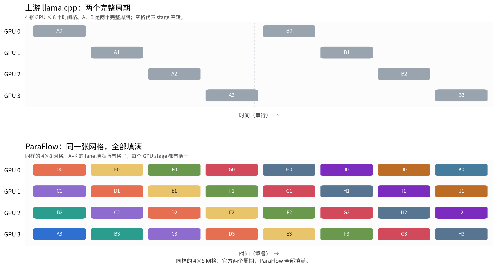
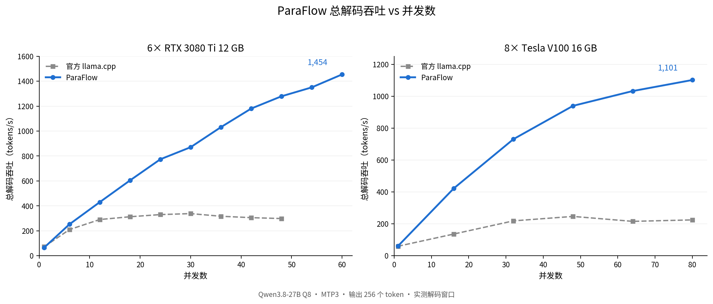

# ParaFlow · 并流

[English](README.md) | **简体中文**

**基于 llama.cpp 的多 GPU 流水线推理引擎。**

ParaFlow 把多张 GPU 组织成一条持续满载的并发推理流水线：请求分成多条 lane，在不同 GPU 上错峰推进；官方PP方案一次只跑一个批次，空出来的 stage 由下一条 lane 补上。

ParaFlow 正是为解决这一GPU浪费而设计的，普通 PCIe 2.0/3.0 服务器也能把多卡吃满，不需要 NVLink，也不需要把模型改成 TP，剩余GPU利用效率达98%以上（例如4卡C32下单流速度与官方C8相当）。

- **PCIe 就能跑**：PP + 多 lane，普通 PCIe 2.0/3.0 多卡机就能扩展。
- **小卡也能加速**：2×V100 16G 在 C8 达到 225.7 t/s，高于单张 V100 32G 的 147.0 t/s。
- **高并发吞吐**：6×3080Ti C60 1,454 t/s；8×V100 C80 1,101 t/s，约为官方 4.9倍。
- **源码完整**：基于 llama.cpp，模型格式和量化方式不变。

## 多卡加速：让每个 stage 都有活干

Layer split 只是把层分到各张卡上，不会自动让这些 stage 保持忙碌。

上游 llama.cpp 一次只推进一个批次。这个批次在采样、等待 KV、或者两段 prompt 之间时，其他 stage 是空着的。ParaFlow 让多条 lane 同时在流水线里跑：



卡数没有变。区别是：stage 1 处理 lane B 时，stage 0 已经在准备 lane C；某条 lane 的 logits 就绪后可以先采样。ParaFlow 把 pipeline lane、异步 decode ticket、动态 KV 和 MTP 组合起来，让 stage 之间的等待被下一条 lane 填上。

## 性能

### Decode



*总 decode 吞吐对并发数。Qwen3.8-27B Q8，MTP3，输出 256 token；官方 llama.cpp 和 ParaFlow 在同并发下测量。*

- **6× RTX 3080 Ti 12 GB**：C60 = **1,454 t/s**。曲线到 C60 仍在上升；进一步加并发受上下文总量限制，没法继续测。
- **8× V100 16 GB**：C80 = **1,101 t/s**，官方 225 t/s，**4.9×**。该点是多次 C80 运行的均值。
- **2× V100 16 GB 对 1× V100 32 GB**，C8：**225.7 vs 147.0 t/s**（+53.5%）。每 GPU 同工作量：225.7 vs 2×112.1 = 224.2 t/s，**≈100%**。
- C1 时两个引擎差不多。加速来自并发，不是把单条请求变快。

这些测试主要在小显存卡上完成。同样的模型和调度在大显存卡上依然成立；大卡能把更多层、上下文和并发留在 GPU 上，进一步榨干多核算力。


### 上下文

- 6× RTX 3080 Ti 总 KV 池：实测 **432K tokens**。
- 8× V100 总 KV 池：实测 **1088K tokens**（1088Ki / 34 slots，单序列上限 32K；首尾 slot 输出一致）。

## 快速开始

已在 V100（SM70）和 RTX 3080 Ti（SM86）上验证；要求 Linux + CUDA。RTX 3080 Ti（SM86；V100 用 `70`）构建：

```sh
cmake -S . -B build -DCMAKE_BUILD_TYPE=Release \
  -DGGML_CUDA=ON -DCMAKE_CUDA_ARCHITECTURES=86 \
  -DGGML_CUDA_GRAPHS=ON -DGGML_NATIVE=OFF \
  -DLLAMA_BUILD_SERVER=ON -DLLAMA_BUILD_UI=OFF
cmake --build build --target llama-server -j8
```

启动 4 卡 layer split 服务。路径、tensor split、上下文和 slot 数按实际硬件调整：

```sh
./build/bin/llama-server \
  -m /models/Qwen3.8-27B.Q8_0.gguf \
  -sm layer -ts 1,1,1,1 -ngl 99 \
  -c 131072 -np 16 \
  -fa on -ctk q8_0 -ctv q8_0 \
  --no-kv-unified \
  --pipe-lanes 4 \
  --kv-dynamic --kv-dynamic-seq-max 8192 \
  --spec-type draft-mtp --spec-draft-n-max 3 \
  --host 0.0.0.0 --port 8080
```

调用：

```sh
curl http://localhost:8080/v1/chat/completions \
  -H 'Content-Type: application/json' \
  -d '{
    "model": "Qwen3.8-27B.Q8_0.gguf",
    "messages": [{"role": "user", "content": "你好"}],
    "temperature": 0.2,
    "max_tokens": 256,
    "mtp": true,
    "speculative.n_max": 3
  }'
```

## 多卡加速怎么调

真正影响多卡加速的参数就这几个：

- `--pipe-lanes N`：直接设为 GPU 数，一卡一条 lane；先跑满，再根据 KV 和调度压力调整。
- `-np N`：服务 slot 数。提高并发时一起加；吞吐曲线是按 slot 数测的。
- `-c N`：开启动态 KV 后，这是**共享** token 预算，不是单 slot 上下文。
- `--kv-dynamic-seq-max N`：单 sequence 上限；开启动态 KV 时必填。
- `--no-kv-unified`：流水线模式必须。
- `--spec-draft-n-max N`：MTP 深度。更深可以提高每次验证的产出，但更占 KV 和验证行数。

动态 KV 还要求 CUDA KV offload 和 Flash Attention；流水线模式要求 `--no-kv-unified`。

先用默认 ubatch；如果显存不够，降低 `-np` 或加卡，`-ub` 等测量后再调。

## 其他参数

这些不改变多卡扩展模型，属于生产策略：

| 参数 | 作用 |
|---|---|
| `--vip` + `priority: 1` | VIP 请求运行时原地暂停普通 slot。 |
| `--kv-spill` | KV 池满时把冻结请求换到主机内存。要求 unified 或 dynamic KV。 |
| `--system-cache-mib N` | 用主机内存缓存共享 system 前缀状态。要求 non-unified KV。 |
| `--loop-guard` | 遇到长段完全重复输出时停止；默认关闭。 |

完整参数和约束见[参数文档](tools/server/README.md)。

## 边界

- 流水线和动态 KV 路径依赖 Linux + CUDA。
- 原生 MTP 要求模型带 NextN/MTP 头。
- 这份源码没有多机流水线。
- 模型权重及其许可证独立。

## 许可与社区

ParaFlow 基于 [llama.cpp](https://github.com/ggml-org/llama.cpp)。上游 MIT 许可证、作者信息和第三方声明保留在 [LICENSE](LICENSE)、[AUTHORS](AUTHORS) 和 [licenses](licenses/) 中；上游文档见 [README.upstream.md](README.upstream.md)。

引擎核心以源码形式完整包含在仓库中，由 CMake 直接构建，不需要单独的闭源内核。

联系方式：dongyiwan1988@qq.com  
社区交流：[LINUX DO](https://linux.do/)。
